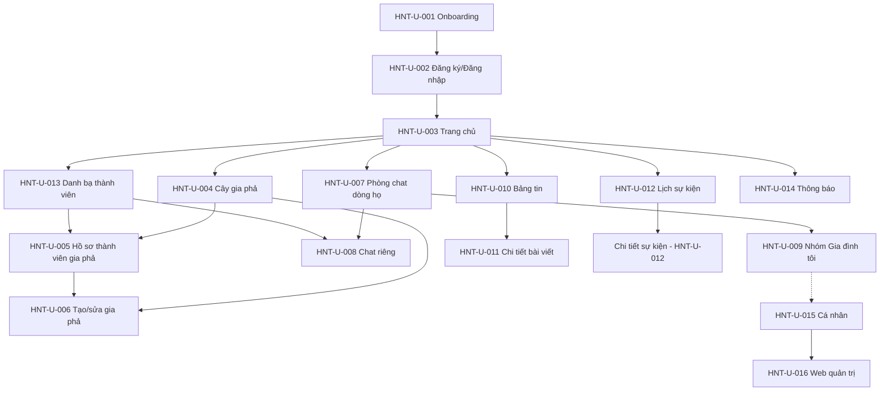

# Đặc tả UI/UX — HỌ NHÀ TÔI

> Tài liệu đặc tả giao diện và trải nghiệm người dùng cho ứng dụng "Họ Nhà Tôi" (mobile Android/iOS; có web quản trị).
> Nguồn yêu cầu: file đặc tả "ĐẶC TẢ" (PRD v1.0 + v1.1 chốt), thư mục HO-NHA-TOI trên Google Drive.
> Quy ước mã màn hình: `HNT-U-xxx`. Mã chức năng tham chiếu: `GP-xx` (phân hệ gia phả), `CHAT-xx` (nhắn tin), `QA-xx` (tiêu chí nghiệm thu phát hành).

---

## 1. Nguyên tắc thiết kế

### 1.1. Ưu tiên người lớn tuổi (yêu cầu bắt buộc — đặc tả 2.3)

Người lớn tuổi là nhóm người dùng trọng tâm. Các quy tắc sau là bắt buộc, không phải tinh chỉnh hậu kỳ:

1. **Chữ dễ đọc, điều chỉnh được:** cỡ chữ mặc định đủ lớn để đọc thoải mái; cho phép người dùng tăng/giảm cỡ chữ trong Cài đặt; giao diện phải co giãn hợp lý khi tăng cỡ chữ, không vỡ layout, không cắt mất nút hành động.
2. **Nút bấm lớn, có nhãn chữ rõ ràng:** mọi hành động chính đều có nút với nhãn tiếng Việt đầy đủ (ví dụ "Gửi ảnh", "Xem gia phả"), không dùng biểu tượng đơn độc cho hành động quan trọng. Vùng chạm tối thiểu 48dp.
3. **Tương phản tốt; không dùng màu sắc làm tín hiệu duy nhất:** mọi trạng thái (thành công, cảnh báo, lỗi, trạng thái xác minh) đều kết hợp màu + biểu tượng + chữ nhãn.
4. **Ít bước cho các luồng phổ biến:** mở phòng chat, xem cây gia phả, xem lịch ngày giỗ, gửi ảnh — mỗi luồng không quá 3 chạm từ màn hình chính của tab tương ứng.
5. **Ngôn ngữ tiếng Việt tự nhiên:** tránh thuật ngữ công nghệ ("đồng bộ", "xác thực 2 yếu tố" phải có giải thích kèm theo); thông báo lỗi nêu rõ chuyện gì xảy ra và người dùng cần làm gì tiếp theo.
6. **Hạn chế thao tác kéo-thả phức tạp:** thêm thành viên vào cây gia phả dùng form từng bước (chọn quan hệ → điền thông tin → xác nhận), có nút phóng to/thu nhỏ dạng nút bấm (+/−) bên cạnh thao tác chạm vuốt.
7. **Hướng dẫn trực quan và phản hồi rõ ràng:** màn hình trống có hướng dẫn bước tiếp theo; mọi hành động quan trọng đều có trạng thái thành công/thất bại dễ hiểu.
8. **Lời mời dễ sử dụng:** mở trực tiếp bằng liên kết hoặc mã QR; người được mời không cần hiểu cấu trúc ứng dụng trước.
9. **Hỗ trợ thiết lập có kiểm soát:** cho phép người thân hỗ trợ tạo tài khoản (chế độ hỗ trợ có xác nhận của chủ tài khoản), nhưng không tự động chia sẻ mật khẩu và không cấp quyền truy cập ngầm cho người hỗ trợ. Có hướng dẫn khôi phục tài khoản khi đổi số điện thoại hoặc mất thiết bị.

### 1.2. Riêng tư theo mặc định (privacy-by-default)

1. Thông tin nhạy cảm (số điện thoại, email, nhóm máu, địa chỉ cụ thể) mặc định ở chế độ riêng tư; người dùng chủ động mở rộng phạm vi chia sẻ.
2. Việc cùng thuộc một dòng họ không đồng nghĩa mọi thông tin được công khai cho nhau.
3. Quản trị viên dòng họ không xem được nội dung chat riêng của thành viên qua bất kỳ giao diện nào.
4. Trạng thái xác minh hồ sơ gia phả được lưu và phân quyền riêng, không gộp với trạng thái hoạt động hay quyền truy cập.

### 1.3. Nguyên tắc chung

- Gia phả là dữ liệu có cấu trúc (không phải ảnh tĩnh); mọi màn hình chỉnh sửa gia phả phải phản ánh quan hệ cha mẹ/con/vợ-chồng một cách rõ ràng.
- Phòng chat (trao đổi nhanh) và bảng tin (lưu trữ lâu dài) là hai phân hệ tách biệt, không gộp giao diện.
- Tài khoản ứng dụng, hồ sơ gia phả và tư cách thành viên dòng họ là ba thực thể riêng — giao diện phải thể hiện sự phân biệt này (đặc biệt trong danh bạ và hồ sơ).

---

## 2. Kiến trúc điều hướng

### 2.1. Thanh điều hướng chính — 5 tab

| Tab | Nội dung chính | Màn hình liên quan |
|---|---|---|
| Trang chủ | Hôm nay trong dòng họ: sinh nhật, ngày giỗ, kỷ niệm; thông báo mới từ ban quản lý; khoảnh khắc gia đình; sự kiện sắp tới + đăng ký tham gia | HNT-U-003, HNT-U-010, HNT-U-012 |
| Gia phả | Cây gia phả (3 chế độ xem), tìm kiếm tổ tiên, hồ sơ thành viên, quản lý quan hệ, tạo/sửa gia phả | HNT-U-004, HNT-U-005, HNT-U-006 |
| Tin nhắn | Phòng chat dòng họ, chat riêng, nhóm "Gia đình tôi", lời mời/yêu cầu nhắn tin | HNT-U-007, HNT-U-008, HNT-U-009 |
| Dòng họ | Danh sách thành viên, các nhánh gia đình, sự kiện, thông báo, quản trị dòng họ | HNT-U-012, HNT-U-013, HNT-U-014 |
| Cá nhân | Hồ sơ của tôi, nhóm gia đình riêng, quyền riêng tư, bảo mật, cài đặt | HNT-U-009, HNT-U-015 |

- Một tài khoản có thể tham gia nhiều dòng họ: các tab Trang chủ, Tin nhắn, Dòng họ có bộ chọn dòng họ hiện tại ở đầu màn hình.
- Khách chưa đăng nhập chỉ xem màn hình giới thiệu và nội dung được công khai.

### 2.2. Nhóm "Gia đình tôi" — điểm truy cập

Theo đặc tả 3.1, nhóm "Gia đình tôi" **không** có tab riêng. Điểm truy cập:

1. **Tab Tin nhắn:** danh sách cuộc trò chuyện hiển thị nhóm gia đình cùng với chat riêng và phòng chat dòng họ; nút "Tạo nhóm gia đình" nổi bật trong tab này.
2. **Tab Cá nhân:** mục "Nhóm gia đình của tôi" liệt kê tất cả nhóm gia đình người dùng tham gia/quản lý, kèm nút tạo mới.

Cả hai điểm truy cập mở cùng một màn hình nhóm (HNT-U-009).

### 2.3. Sơ đồ điều hướng tổng thể

---

## 3. Đặc tả từng màn hình

### HNT-U-001 — Onboarding / Giới thiệu

- **Mục đích:** giới thiệu 4 giá trị cốt lõi (gia phả số, danh bạ họ hàng, kết nối chat, ngày giỗ/sự kiện); dẫn người dùng mới tới đăng ký/đăng nhập.
- **Thành phần giao diện chính:**
  - Chuỗi 3–4 slide minh họa, mỗi slide một giá trị cốt lõi kèm một câu mô tả ngắn bằng tiếng Việt phổ thông.
  - Chỉ báo trang (chấm tròn) và nút "Bỏ qua".
  - Hai nút hành động chính: "Đăng ký" (nổi bật) và "Đăng nhập"; liên kết phụ "Xem trước nội dung công khai" cho khách chưa đăng nhập.
- **Tương tác chính:** vuốt hoặc chạm chấm tròn để chuyển slide; chạm "Bỏ qua" vào thẳng đăng nhập; chạm "Xem trước" mở chế độ khách (chỉ nội dung công khai).
- **Các trạng thái:** đang tải (skeleton nếu ảnh minh họa tải chậm); lỗi tải tài nguyên (hiển thị slide chữ thay thế, không chặn luồng đăng ký).

### HNT-U-002 — Đăng ký / Đăng nhập / OTP / Khôi phục tài khoản

- **Mục đích:** tạo tài khoản mới, đăng nhập tài khoản hiện có, khôi phục khi đổi số/mất thiết bị; hỗ trợ người thân thiết lập tài khoản một cách an toàn.
- **Thành phần giao diện chính:**
  - Hai thẻ chuyển đổi: "Đăng nhập" và "Đăng ký".
  - Đăng ký/đăng nhập bằng số điện thoại: ô nhập số điện thoại (tự định dạng đầu số Việt Nam), nút "Gửi mã OTP"; màn hình nhập OTP 6 ô, tự điền khi nhận SMS, đồng hồ đếm ngược và nút "Gửi lại mã".
  - Phương thức email: ô email + mật khẩu, hoặc "Gửi liên kết đăng nhập qua email".
  - Nút "Đăng nhập với Google / Apple" (nếu triển khai).
  - Liên kết "Quên mật khẩu / Khôi phục tài khoản" dẫn tới luồng khôi phục nhiều bước (xác minh danh tính, không chỉ dựa vào OTP).
  - Chế độ "Người thân hỗ trợ thiết lập": người hỗ trợ thao tác dưới sự xác nhận của chủ tài khoản trên chính thiết bị của họ; màn hình nêu rõ người hỗ trợ không được biết mật khẩu và không được cấp quyền truy cập sau khi hoàn tất.
  - Mục "Phiên đăng nhập" (trong Cá nhân): liệt kê thiết bị đang đăng nhập, nút "Đăng xuất khỏi thiết bị này/tất cả".
- **Tương tác chính:** gửi/nhập lại OTP; chuyển đổi phương thức đăng nhập; khôi phục tài khoản theo hướng dẫn từng bước.
- **Các trạng thái:** OTP sai (báo số lần thử còn lại), OTP hết hạn, số điện thoại đã được đăng ký (gợi ý đăng nhập), mất kết nối mạng (giữ lại số đã nhập), khôi phục thất bại (hướng dẫn liên hệ hỗ trợ).

### HNT-U-003 — Trang chủ

- **Mục đích:** người dùng mở app là biết ngay "hôm nay gia đình có việc gì", không phải lục từng nhóm chat.
- **Thành phần giao diện chính:**
  - Bộ chọn dòng họ hiện tại (nếu tham gia nhiều dòng họ).
  - Thẻ "Hôm nay trong dòng họ": sinh nhật, ngày giỗ, lễ kỷ niệm diễn ra hôm nay (chỉ những mục người dùng được phép xem).
  - Mục "Thông báo mới": thông báo của ban quản lý dòng họ, lịch họp họ, thay đổi kế hoạch cần xác nhận.
  - Mục "Khoảnh khắc gia đình": ảnh hoạt động, họp mặt, cưới hỏi, sinh con (dạng lưới ảnh, chạm để xem).
  - Mục "Sự kiện sắp tới": giỗ tổ, họp họ, liên hoan kèm nút "Đăng ký tham gia" và số người đã đăng ký.
- **Tương tác chính:** chạm thẻ sự kiện/thông báo để xem chi tiết (HNT-U-012/HNT-U-011); đăng ký/hủy đăng ký tham gia sự kiện; kéo để làm mới.
- **Các trạng thái:** trống — chưa có sự kiện/thông báo nào thì hiển thị gợi ý ("Chưa có sự kiện nào. Xem lịch dòng họ" kèm nút điều hướng); đang tải — skeleton cho từng thẻ; lỗi — thông báo ngắn và nút "Thử lại".

### HNT-U-004 — Cây gia phả (3 chế độ xem)

- **Mục đích:** xem quan hệ huyết thống nhiều thế hệ, nhiều chi/nhánh; là màn hình lõi của ứng dụng (GP-02).
- **Thành phần giao diện chính:**
  - Thanh chuyển chế độ xem: "Cây dọc" / "Cây ngang" / "Danh sách theo thế hệ" (nút có nhãn chữ, không chỉ biểu tượng).
  - Vùng vẽ cây: mỗi nút thành viên hiển thị ảnh đại diện, họ tên và đời thứ; nút của người đã mất có dấu hiệu phân biệt nhẹ (ví dụ khung khác) kèm chữ, không chỉ dựa vào màu.
  - Thanh tìm kiếm: tìm theo họ tên, tên thường gọi/bí danh, quê quán, thế hệ (GP-05).
  - Thanh trạng thái: "Đời thứ X · N thành viên · đang xem chi Y".
  - Cụm nút thu/phóng (+/−) cố định trên màn hình cho người lớn tuổi, bên cạnh thao tác chạm vuốt.
  - Nút "Thêm thành viên" đặt tại vị trí đã chọn trên cây (mở form HNT-U-006, không dùng kéo-thả).
- **Tương tác chính:** chạm nút thành viên để mở hồ sơ (HNT-U-005); kéo để di chuyển, pinch hoặc nút +/− để thu/phóng; chạm giữ (hoặc nút "..." trên nút thành viên) để mở menu "Đề xuất sửa" / "Báo thông tin mâu thuẫn" (GP-06, GP-07).
- **Các trạng thái:** trống — chưa có cây gia phả thì hiển thị hướng dẫn và nút "Tạo gia phả mới" (GP-01); đang tải — cây lớn tải theo nhánh/thế hệ, hiển thị vùng đang tải và cho phép tương tác với phần đã tải; lỗi tải nhánh — nút "Tải lại nhánh này"; kết quả tìm kiếm rỗng — gợi ý kiểm tra chính tả hoặc phạm vi quyền xem.

### HNT-U-005 — Hồ sơ thành viên gia phả

- **Mục đích:** xem đầy đủ thông tin một người trong gia phả theo đúng quyền được cấp (GP-04, đặc tả 3.3).
- **Thành phần giao diện chính:**
  - Phần đầu: ảnh đại diện, họ tên, tên thường gọi, "Đời thứ N · Chi X", huy hiệu trạng thái xác minh (xem mục 5).
  - Các nhóm thông tin dạng thẻ gấp/mở: Thông tin cơ bản (ngày sinh/mất, giới tính, quê quán, nơi ở hiện tại); Gia đình & quan hệ (cha mẹ, vợ/chồng, con cái, anh chị em — mỗi người là liên kết chạm để điều hướng); Học tập & công việc; Thông tin bổ sung (sở thích, thành tích, tiểu sử); Nhóm máu — chỉ hiển thị với người được cấp quyền, mặc định ẩn; Tư liệu gia đình (ảnh, video, tài liệu).
  - Trường bị giới hạn quyền hiển thị dòng "Riêng tư" thay vì giá trị.
  - Cụm nút hành động theo quyền: "Đề xuất sửa" (GP-06), "Yêu cầu xác minh" (GP-07), "Báo trùng/sai" (GP-08).
  - Nếu hồ sơ là của chính người dùng và chưa liên kết tài khoản: banner "Đây có phải là bạn? Xác minh để liên kết tài khoản" (chống tạo hồ sơ trùng, QA-02).
- **Tương tác chính:** mở/đóng từng nhóm thông tin; chạm tên người thân để chuyển hồ sơ; gửi đề xuất sửa (mở form HNT-U-006 ở chế độ đề xuất).
- **Các trạng thái:** hồ sơ ở trạng thái chờ xác minh/tranh chấp/nháp — hiển thị banner trạng thái tương ứng (mục 5), dữ liệu hiện tại vẫn xem được; đang tải — skeleton; lỗi — nút thử lại; không đủ quyền xem — thông báo rõ phạm vi bị hạn chế.

### HNT-U-006 — Tạo / sửa gia phả

- **Mục đích:** khởi tạo gia phả mới (GP-01) và thêm/sửa thành viên, quan hệ theo quyền (GP-03, GP-06, GP-11).
- **Thành phần giao diện chính:**
  - **Tạo gia phả mới (form từng bước):** tên gia phả (ví dụ "Gia phả họ Nguyễn tại Đồng Nai"); chi/nhánh; quê quán (tỉnh/thành, xã/phường); địa chỉ nhà thờ họ; tổ tiên khởi nguồn; ảnh (tổ tiên, nhà thờ họ, gia huy/biểu tượng dòng họ); phạm vi truy cập (riêng tư / thành viên được duyệt / công khai một phần) dạng lựa chọn radio có giải thích; mời người thân tham gia; đặt quyền (xem, sửa, thêm thành viên, xuất dữ liệu).
  - **Thêm thành viên:** chọn quan hệ với người đã chọn trên cây (cha, mẹ, con, vợ/chồng, con nuôi, cha/mẹ nuôi, tái hôn...) bằng danh sách nút chọn có nhãn rõ ràng; form nhập thông tin từng bước; trước khi lưu, hệ thống kiểm tra trùng người và hiển thị cảnh báo "Có thể đã tồn tại hồ sơ: ..." để người dùng xác nhận (GP-08).
  - **Sửa/đề xuất sửa:** người không có quyền sửa trực tiếp chỉ gửi "đề xuất" — form ghi rõ nội dung đề xuất và lý do; thay đổi quan trọng (quan hệ cha mẹ/vợ chồng, ngày sinh/mất) luôn đi qua bước xác minh.
  - Liên kết "Xem lịch sử chỉnh sửa" (GP-09): danh sách người sửa, thời gian, nội dung trước/sau.
- **Tương tác chính:** điền form theo wizard có thanh tiến trình; lưu nháp; gửi đề xuất chờ duyệt; xác nhận khi có cảnh báo trùng.
- **Các trạng thái:** lỗi nhập liệu hiển thị ngay dưới từng trường (chữ đỏ + biểu tượng, không chỉ viền đỏ); đang lưu — nút chuyển trạng thái chờ và chặn gửi trùng; đề xuất đã gửi — màn hình xác nhận "Đã gửi, đang chờ xác minh".

### HNT-U-007 — Phòng chat dòng họ

- **Mục đích:** trao đổi nhanh trong dòng họ; tách bạch với bảng tin lưu trữ lâu dài (CHAT-01..CHAT-16).
- **Thành phần giao diện chính:**
  - Đầu phòng: tên dòng họ, ảnh đại diện, mô tả, số lượng thành viên; nút mở thông tin nhóm.
  - Luồng tin nhắn: văn bản (CHAT-01), emoji (CHAT-02), ảnh (CHAT-03, xem toàn màn hình), video (CHAT-04), tệp đính kèm (CHAT-05), tin nhắn thoại (giai đoạn 2 — hiển thị trong đặc tả nhưng gắn nhãn "sắp có" ở MVP nếu chưa triển khai), trả lời tin nhắn (CHAT-07, hiển thị trích dẫn CHAT-16), chuyển tiếp (CHAT-08), thả cảm xúc (CHAT-09), sửa (CHAT-10, có dấu "đã chỉnh sửa"), thu hồi (CHAT-11, hiển thị trạng thái), xóa (CHAT-12, phân biệt xóa phía mình/xóa mọi người), ghim (CHAT-13), tìm kiếm (CHAT-14), trạng thái gửi/nhận/đọc (CHAT-15).
  - Thanh nhập liệu: ô nhập lớn, nút gửi có nhãn, nút đính kèm có nhãn ("Ảnh", "Tệp").
  - Thẻ phụ trong thông tin nhóm: Thành viên & vai trò; Tệp/ảnh/video đã chia sẻ; Sự kiện nhóm; Bình chọn; Thông báo quan trọng (quản trị viên đăng, có thể yêu cầu xác nhận đã đọc).
  - Công cụ quản trị: duyệt thành viên, liên kết mời (có hạn/thu hồi được), gán quản trị viên/phó, cấu hình ai được gửi tin/ghim/thêm thành viên, tắt thông báo, xử lý thành viên vi phạm, lịch sử thay đổi thành viên & quyền.
- **Tương tác chính:** gửi/nhận realtime; ghim thông báo; tạo sự kiện/bình chọn từ trong nhóm; mời thành viên bằng liên kết/QR.
- **Các trạng thái:** trống — phòng mới hiển thị lời chào và nội quy nhóm; đang tải — tải lịch sử phân trang khi cuộn lên; lỗi mạng — tin nhắn lỗi vào hàng đợi gửi lại, có cơ chế chống trùng (QA-08); bị tắt quyền gửi tin — thanh nhập hiển thị lý do.

### HNT-U-008 — Chat riêng

- **Mục đích:** nhắn tin 1-1; nhắn cho người chưa kết bạn phải qua quy trình yêu cầu nhắn tin có kiểm soát spam.
- **Thành phần giao diện chính:**
  - Danh sách cuộc trò chuyện: tìm kiếm, ghim, đánh dấu chưa đọc, lưu trữ, tắt thông báo, xóa khỏi danh sách (chỉ phía mình).
  - Màn hình chat: đầy đủ tính năng như phòng chat (văn bản, emoji, ảnh/video/tệp, thoại theo giai đoạn; trả lời, chuyển tiếp, sửa, thu hồi, reaction, ghim, tìm kiếm trong cuộc trò chuyện); tùy chỉnh hình nền và tên gợi nhớ; chia sẻ hồ sơ thành viên/liên kết gia phả theo quyền.
  - Hộp "Yêu cầu nhắn tin" (người lạ): hiển thị số tin nhắn giới hạn còn lại, không cho gửi ồ ạt ảnh/video, không hiển thị trạng thái trực tuyến của người nhận; các nút "Chấp nhận" / "Từ chối" / "Chặn" / "Báo cáo".
  - Tìm người: tìm theo tên, tên tài khoản, số điện thoại (nếu được phép) → mở hồ sơ → nút "Nhắn tin".
  - Quản lý kết nối: gửi/chấp nhận/từ chối/hủy kết bạn; chặn (ngăn mọi liên hệ theo chính sách); báo cáo (ghi lý do, trạng thái xử lý).
- **Tương tác chính:** bắt đầu chat từ danh bạ/hồ sơ; xử lý yêu cầu nhắn tin; chặn/báo cáo người quấy rối.
- **Các trạng thái:** yêu cầu đang chờ (cả phía gửi và phía nhận); đã chặn — chặn gửi tin và hiển thị trạng thái; cuộc trò chuyện đã xóa — biến mất khỏi danh sách phía mình; lỗi gửi — gửi lại.

### HNT-U-009 — Nhóm "Gia đình tôi" (tạo + quản lý)

- **Mục đích:** không gian riêng tư của gia đình nhỏ (ông bà, cha mẹ, con cái...) bên trong dòng họ lớn.
- **Điểm truy cập:** tab Tin nhắn (nút "Tạo nhóm gia đình") và tab Cá nhân (mục "Nhóm gia đình của tôi").
- **Thành phần giao diện chính:**
  - **Tạo nhóm (form từng bước):** tên nhóm (ví dụ "Gia đình nhà Phụng"), ảnh đại diện, mời thành viên (từ danh bạ/dòng họ/liên kết mời), chọn quản trị viên, chọn quyền riêng tư và quyền thành viên, nút "Tạo nhóm".
  - **Trong nhóm:** chat đầy đủ tính năng (như HNT-U-007); album ảnh gia đình; lịch sự kiện & nhắc lịch; bình chọn; danh sách công việc chuẩn bị sự kiện (giỗ, cưới, họp mặt); chia sẻ khoản đóng góp/chi phí chung (phạm vi người xem hiển thị rõ ràng); thông báo sinh nhật, ngày kỷ niệm; quản lý thành viên & vai trò; lịch sử thay đổi nhóm; tùy chỉnh thông báo và quyền riêng tư.
- **Lưu ý kiến trúc hiển thị:** thành viên nhóm chat không đồng nghĩa quan hệ huyết thống (con rể, con dâu, người được mời) — giao diện không tự gán quan hệ gia phả; quyền sửa gia phả không đi kèm quyền thành viên nhóm.
- **Tương tác chính:** tạo nhóm, mời/quản lý thành viên, tạo album/sự kiện/bình chọn từ trong nhóm.
- **Các trạng thái:** trống — nhóm mới có hướng dẫn mời thành viên; đang tải; lỗi; nhóm đã bị giải tán — hiển thị thông báo và khóa tương tác.

### HNT-U-010 — Bảng tin dòng họ

- **Mục đích:** nơi lưu nội dung lâu dài của dòng họ: thông báo, hoạt động, tư liệu, kỷ niệm, tìm người thân — tìm lại được, không trôi như chat.
- **Thành phần giao diện chính:**
  - Bộ lọc: theo loại bài (thông báo, hoạt động, tư liệu, kỷ niệm, tìm kiếm người thân), người đăng, thời gian.
  - Thẻ bài viết: văn bản, ảnh, video, album; tên người đăng, thời gian, phạm vi người xem (dòng họ/nhánh/nhóm).
  - Tương tác trên thẻ: bình luận, thả cảm xúc, chia sẻ trong phạm vi cho phép, ghim (quản trị), báo cáo vi phạm.
  - Nút "Đăng bài" nổi bật; khi đăng bài chọn phạm vi người xem.
  - Banner phân biệt: "Bảng tin lưu trữ lâu dài — thảo luận nhanh dùng phòng chat".
- **Tương tác chính:** đăng bài (văn bản/ảnh/video/album), bình luận, lọc, báo cáo, chia sẻ liên kết bài viết ra ứng dụng khác.
- **Các trạng thái:** trống — chưa có bài viết thì gợi ý đăng bài đầu tiên; đang tải — skeleton; lỗi — thử lại; bài bị giới hạn quyền — không hiển thị với người không được phép.

### HNT-U-011 — Chi tiết bài viết

- **Mục đích:** đọc đầy đủ và thảo luận về một bài viết.
- **Thành phần giao diện chính:** nội dung bài đầy đủ; thông tin người đăng và phạm vi hiển thị; cụm reaction; danh sách bình luận (phân trang, trả lời bình luận); hộp nhập bình luận; nút chia sẻ (tạo liên kết ra ứng dụng khác), nút báo cáo; với quản trị viên: ghim/gỡ ghim, xóa bài vi phạm.
- **Tương tác chính:** bình luận, reaction, chia sẻ, báo cáo.
- **Các trạng thái:** bài viết đã bị xóa hoặc người xem không còn quyền — hiển thị thông báo thay vì nội dung; đang tải; lỗi.

### HNT-U-012 — Lịch sự kiện + chi tiết sự kiện

- **Mục đích:** quản lý giỗ tổ, ngày giỗ, sinh nhật, họp họ, họp mặt của dòng họ/nhóm gia đình.
- **Thành phần giao diện chính:**
  - **Màn hình lịch:** chuyển đổi "Tháng" / "Sắp tới"; mỗi sự kiện hiển thị đồng thời ngày âm và ngày dương; bộ lọc loại (giỗ, sinh nhật, họp họ, khác); dấu nhắc sự kiện quan trọng.
  - **Chi tiết sự kiện:** tên, loại, ngày âm + ngày dương, giờ và múi giờ, địa điểm, người tổ chức, nội dung; danh sách khách mời kèm trạng thái (sẽ tham gia / từ chối / chưa trả lời); nút "Xác nhận tham gia"; bình chọn thời gian/địa điểm; sau sự kiện: ảnh, biên bản, tư liệu.
  - **Tạo sự kiện (form từng bước):** loại sự kiện, tiêu đề, ngày (chọn âm/dương, tự quy đổi), giờ, địa điểm, phạm vi mời (dòng họ/nhánh/nhóm), gửi lời mời, bật nhắc lịch.
- **Tương tác chính:** xem lịch, xác nhận tham dự, tạo sự kiện, bình chọn, tải tư liệu sau sự kiện.
- **Các trạng thái:** trống — tháng/khoảng thời gian không có sự kiện thì gợi ý tạo mới; đang tải; lỗi; sự kiện đã qua — chuyển sang chế độ xem tư liệu, khóa đăng ký tham gia.

### HNT-U-013 — Danh bạ thành viên

- **Mục đích:** tìm kiếm và liên hệ người thân trong dòng họ.
- **Thành phần giao diện chính:**
  - Thanh tìm kiếm: theo tên, quê quán, nơi ở, nghề nghiệp.
  - Bộ lọc: tỉnh/thành, chi/nhánh, thế hệ, nhóm gia đình.
  - Thẻ thành viên: ảnh đại diện, họ tên, chi/nhánh, thông tin liên hệ trong phạm vi được phép xem; dấu phân biệt trực quan hai loại: "trong gia phả" (có thể chưa dùng app) và "đang dùng app".
  - Menu hành động trên thẻ: mở hồ sơ gia phả, nhắn tin, kết bạn, xem quan hệ gia phả, yêu cầu bổ sung/sửa/xác minh hồ sơ, báo cáo hồ sơ sai/trùng/giả mạo.
- **Tương tác chính:** tìm, lọc, mở hồ sơ, bắt đầu nhắn tin/kết bạn, gửi yêu cầu hiệu đính hồ sơ.
- **Các trạng thái:** không tìm thấy kết quả — gợi ý nới lỏng điều kiện; đang tải — phân trang khi cuộn; lỗi — thử lại.

### HNT-U-014 — Thông báo

- **Mục đích:** không bỏ lỡ tin nhắn, lời mời, yêu cầu xác minh, ngày giỗ và sự kiện quan trọng.
- **Thành phần giao diện chính:**
  - Danh sách thông báo nhóm theo loại: tin nhắn mới; lời mời kết bạn/yêu cầu nhắn tin; mời tham gia dòng họ/nhóm gia đình; yêu cầu tham gia chờ duyệt; sự kiện/ngày giỗ sắp diễn ra; hồ sơ gia phả được cập nhật hoặc cần xác minh; thông báo quan trọng từ quản trị viên; phản hồi yêu cầu hỗ trợ.
  - Mỗi thông báo chạm để điều hướng đúng màn hình liên quan; chấm "chưa đọc".
  - Màn hình cài đặt thông báo: âm thanh, giờ yên lặng, bật/tắt theo từng nhóm; hệ thống chống gửi trùng cho sự kiện quan trọng.
- **Tương tác chính:** xem, đánh dấu đã đọc, tùy chỉnh thông báo theo nhóm và khung giờ.
- **Các trạng thái:** trống — "Bạn đã xem hết thông báo"; đang tải; người dùng tắt quyền push hệ thống — hiển thị hướng dẫn bật lại.

### HNT-U-015 — Cá nhân / Cài đặt / Quyền riêng tư

- **Mục đích:** quản lý hồ sơ, nhóm gia đình, riêng tư, bảo mật và tùy chọn ứng dụng.
- **Thành phần giao diện chính:**
  - Hồ sơ của tôi: xem/chỉnh sửa thông tin; từng nhóm trường có tùy chọn phạm vi hiển thị (công khai / thành viên dòng họ / chỉ mình).
  - Mục "Nhóm gia đình của tôi": danh sách nhóm đang tham gia + nút "Tạo nhóm gia đình" (đi tới HNT-U-009).
  - Quyền riêng tư: ai được nhắn tin cho tôi; ai xem được số điện thoại, email, ngày sinh; quản lý danh sách chặn.
  - Bảo mật: đổi mật khẩu; đăng nhập bằng khóa truy cập/passkey (chuẩn FIDO2/WebAuthn) nếu triển khai; quản lý phiên đăng nhập; đăng xuất.
  - Cài đặt chung: cỡ chữ (theo 1.1), ngôn ngữ, âm thanh thông báo, giờ yên lặng, chủ đề sáng/tối (nếu có).
  - Dữ liệu của tôi: yêu cầu tải xuống, sửa, xóa dữ liệu cá nhân; xóa tài khoản (màn hình nêu rõ chính sách: xóa tài khoản không tự động xóa lịch sử gia phả của người khác).
- **Tương tác chính:** chỉnh sửa hồ sơ, đặt phạm vi riêng tư từng trường, quản lý phiên và bảo mật.
- **Các trạng thái:** đang tải; lưu thất bại — giữ lại giá trị đã nhập và báo lỗi cụ thể; xác nhận trước các hành động nhạy cảm (xóa tài khoản, đăng xuất tất cả).

### HNT-U-016 — Web quản trị (desktop)

- **Mục đích:** quản trị dòng họ và vận hành nền tảng.
- **Thành phần giao diện chính:**
  - Tổng quan: số liệu thành viên, yêu cầu tham gia chờ duyệt, đề xuất gia phả chờ xác minh, tranh chấp đang mở, nội dung bị báo cáo.
  - Duyệt thành viên & phân vai trò theo từng dòng họ (người quản lý gia phả, quản trị viên dòng họ, quản trị viên cấp cao).
  - Quản lý gia phả: xem lịch sử chỉnh sửa (trước/sau), xử lý tranh chấp, khôi phục dữ liệu theo chính sách.
  - Quản lý nội dung: xem xét bài viết/bình luận bị báo cáo, ẩn/xóa theo quy định.
  - Nhật ký kiểm toán: mọi thao tác nhạy cảm (cấp quyền, xóa dữ liệu, xử lý tranh chấp) đều ghi nhật ký và hiển thị tại đây.
  - Vận hành: sao lưu/khôi phục, xử lý yêu cầu dữ liệu cá nhân, xử lý sự cố.
- **Quy tắc hiển thị bắt buộc:** không có màn hình nào cho phép đọc nội dung chat riêng của thành viên; thao tác nhạy cảm yêu cầu hộp xác nhận nêu rõ hậu quả.
- **Các trạng thái:** đang tải; lỗi; tài khoản không đủ quyền — hiển thị thông báo phân quyền thay vì trang trắng.

---

## 4. Luồng thao tác chính

### Luồng F1 — Đăng ký → tham gia dòng họ → được duyệt

1. Người dùng mới mở app → HNT-U-001 (Onboarding) → chọn "Đăng ký".
2. HNT-U-002: nhập số điện thoại → nhận OTP → nhập OTP → tạo tài khoản thành công (thông báo rõ ràng).
3. Người dùng tìm dòng họ (tìm kiếm) hoặc mở liên kết/QR mời (xem F4).
4. Màn hình giới thiệu dòng họ: tên, quê quán, số thành viên, nội quy → nút "Gửi yêu cầu tham gia".
5. Form yêu cầu: chọn nhánh gia đình (nếu biết), khai báo quan hệ với dòng họ (ô chữ tự do, không bắt buộc).
6. Hệ thống báo "Đã gửi yêu cầu — quản trị viên sẽ xác minh"; người dùng xem được trạng thái yêu cầu trong Thông báo (HNT-U-014).
7. Quản trị viên duyệt trên HNT-U-016 hoặc trong app → người dùng nhận thông báo "Được chấp thuận" và được cấp quyền thành viên dòng họ.
8. Trường hợp bị từ chối: thông báo nêu lý do (nếu có) và hướng dẫn liên hệ quản trị viên.

### Luồng F2 — Đóng góp dữ liệu gia phả → xác minh → xử lý tranh chấp

1. Thành viên dòng họ mở HNT-U-004, chọn vị trí trên cây → "Thêm thành viên" hoặc mở hồ sơ (HNT-U-005) → "Đề xuất sửa".
2. HNT-U-006 (chế độ đề xuất): điền thông tin + lý do đề xuất → gửi.
3. Hệ thống kiểm tra trùng người (GP-08): nếu nghi trùng, hiển thị hồ sơ nghi trùng để người dùng xác nhận "đây là người khác" hoặc hủy và bổ sung vào hồ sơ có sẵn.
4. Đề xuất chuyển trạng thái `pending_verification`; người quản lý gia phả nhận thông báo.
5. Người quản lý xem đề xuất ở chế độ so sánh trước/sau → "Duyệt" (cập nhật gia phả, ghi nhật ký GP-09) hoặc "Yêu cầu bổ sung" (trả về kèm ghi chú).
6. Nếu có thành viên phản đối thông tin đã duyệt: tạo "tranh chấp" → hồ sơ chuyển trạng thái `disputed`, hiển thị banner tranh chấp; quản trị viên cấp cao xử lý, kết luận được ghi nhật ký; hồ sơ trở về `verified` hoặc cập nhật theo kết luận.
7. Mọi bước đều có thông báo cho người đề xuất về trạng thái xử lý.

### Luồng F3 — Nhắn tin với người lạ (tìm → yêu cầu → chấp nhận/từ chối/chặn)

1. Người A tìm người B trong Danh bạ (HNT-U-013) hoặc nhập tên tài khoản/số điện thoại (nếu được phép).
2. Mở hồ sơ rút gọn của B → nút "Nhắn tin".
3. Vì chưa kết nối: hệ thống mở hộp "Yêu cầu nhắn tin" — A soạn tối đa số tin nhắn giới hạn, không gửi được nhiều ảnh/video; B không lộ trạng thái trực tuyến.
4. B nhận thông báo "Yêu cầu nhắn tin từ A" trong HNT-U-014 và hộp yêu cầu trong HNT-U-008.
5. B chọn: **Chấp nhận** → mở cuộc trò chuyện bình thường theo quyền riêng tư của hai bên; **Từ chối** → đóng yêu cầu, A nhận thông báo từ chối chung chung, bị hạn chế gửi lại liên tục; **Chặn** → A không thể liên hệ B nữa theo chính sách chặn; **Báo cáo** → ghi nhận lý do và chuyển bộ phận xử lý.
6. Quy tắc hiển thị: phân biệt rõ ba hành động "xóa cuộc trò chuyện" (chỉ phía mình), "thu hồi tin nhắn" và "chặn người dùng" — không dùng chung một nút hay một cơ chế.

### Luồng F4 — Mời tham gia qua liên kết / mã QR

1. Quản trị viên (hoặc thành viên được phép) mở thông tin phòng chat/nhóm/dòng họ → "Mời thành viên" → chọn "Tạo liên kết mời" hoặc "Hiện mã QR".
2. Màn hình hiển thị tùy chọn: thời hạn hiệu lực, số lượt dùng tối đa, nút "Thu hồi liên kết".
3. Người mời chia sẻ liên kết/QR qua Zalo, SMS hoặc ứng dụng khác (đặc tả 2.1: không yêu cầu người dùng rời Zalo).
4. Người được mời mở liên kết/QR → xem trang giới thiệu ngắn gọn của dòng họ/nhóm → nút "Tham gia" (đăng nhập hoặc đăng ký nhanh nếu chưa có tài khoản, tối đa 3 bước).
5. Nếu cần duyệt: chuyển sang bước 4–7 của luồng F1; nếu liên kết cho phép tham gia trực tiếp: vào thẳng không gian tương ứng.
6. Liên kết hết hạn hoặc bị thu hồi: trang mời hiển thị "Liên kết đã hết hạn" kèm hướng dẫn xin liên kết mới.

### Luồng F5 — Tạo sự kiện giỗ / họp họ

1. Từ Trang chủ (HNT-U-003), tab Dòng họ hoặc trong nhóm "Gia đình tôi": nút "Tạo sự kiện".
2. HNT-U-012 (form từng bước): chọn loại (giỗ tổ, ngày giỗ, họp họ, sinh nhật, khác) → tiêu đề → ngày (chọn lịch âm hoặc dương, hệ thống tự quy đổi và hiển thị cả hai) → giờ, múi giờ → địa điểm → phạm vi mời (dòng họ / nhánh / nhóm gia đình) → bật nhắc lịch.
3. Xem lại tổng hợp → "Gửi lời mời".
4. Người được mời nhận thông báo → mở chi tiết sự kiện → "Xác nhận tham gia" / "Từ chối".
5. Trước sự kiện: hệ thống gửi nhắc lịch (chống gửi trùng lặp).
6. Sau sự kiện: người tổ chức tải ảnh, biên bản, tư liệu lên chi tiết sự kiện để lưu trữ.

---

## 5. Quy tắc hiển thị trạng thái xác minh hồ sơ

Mỗi hồ sơ gia phả có đúng một trạng thái xác minh tại một thời điểm: `draft`, `pending_verification`, `verified`, `disputed`. Trạng thái được lưu tách biệt với trạng thái hoạt động và quyền truy cập, có phân quyền xem riêng.

| Trạng thái | Nhãn hiển thị | Quy tắc giao diện |
|---|---|---|
| `draft` (nháp) | "Bản nháp" | Huy hiệu xám + biểu tượng bút chì. Chỉ người tạo và người quản lý gia phả nhìn thấy; không xuất hiện trong tìm kiếm công khai của dòng họ. |
| `pending_verification` (chờ xác minh) | "Chờ xác minh" | Huy hiệu vàng hổ phách + biểu tượng đồng hồ. Dữ liệu hiện tại (nếu có) vẫn hiển thị bình thường; nội dung đề xuất chỉ hiển thị cho người duyệt ở chế độ so sánh trước/sau. Người xem thông thường thấy banner "Thông tin đang chờ xác minh". |
| `verified` (đã xác minh) | "Đã xác minh" | Huy hiệu xanh lá + biểu tượng dấu kiểm. Hiển thị đầy đủ theo quyền truy cập của người xem. |
| `disputed` (tranh chấp) | "Đang tranh chấp" | Huy hiệu đỏ + biểu tượng cảnh báo + chữ nhãn. Hiển thị banner nêu ngắn gọn nội dung tranh chấp và hướng xử lý ("đang được quản trị viên xem xét"); không ẩn toàn bộ hồ sơ trừ khi quản trị viên quyết định. |

Quy tắc chung:

1. Không dùng màu sắc làm tín hiệu duy nhất — mọi trạng thái đều có nhãn chữ và biểu tượng đi kèm.
2. Lịch sử chuyển trạng thái (ai, khi nào, lý do) xem được trong "Lịch sử chỉnh sửa" (GP-09) theo quyền.
3. Thay đổi trạng thái quan trọng (duyệt, đánh dấu tranh chấp, kết luận tranh chấp) phải có xác nhận của người thực hiện và được ghi nhật ký kiểm toán.

---

## 6. Tiêu chí nghiệm thu usability cho người lớn tuổi

Thực hiện thử nghiệm sử dụng với người dùng thuộc nhóm tuổi mục tiêu (người lớn tuổi, bao gồm người ít kinh nghiệm dùng smartphone) trên thiết bị và mạng thực tế.

**Nhiệm vụ kiểm thử (task-based):**

| # | Nhiệm vụ | Điểm bắt đầu |
|---|---|---|
| UT-01 | Đăng ký tài khoản bằng số điện thoại và mã OTP | Màn hình Onboarding (HNT-U-001) |
| UT-02 | Mở liên kết/QR mời và tham gia dòng họ | Nhận liên kết mời ngoài app |
| UT-03 | Mở phòng chat dòng họ, gửi một tin nhắn văn bản và một ảnh | Tab Tin nhắn |
| UT-04 | Xem cây gia phả và mở hồ sơ của một thành viên | Tab Gia phả |
| UT-05 | Xem ngày giỗ sắp tới trong lịch | Tab Trang chủ hoặc Dòng họ |

**Tiêu chí đạt:**

1. Người tham gia hoàn thành cả 5 nhiệm vụ mà **không cần người khác hướng dẫn liên tục** (được phép có hướng dẫn khởi đầu và trợ giúp ngữ cảnh trong app như tooltip, màn hình trống có hướng dẫn).
2. Không có nhiệm vụ nào bị bỏ dở do không hiểu giao diện (ví dụ: không tìm thấy nút hành động, không hiểu thông báo lỗi).
3. Các lỗi thao tác phổ biến (nhập sai OTP, gửi nhầm) đều có đường khôi phục rõ ràng mà người tham gia tự thực hiện được.

**Ghi chú:** các mục tiêu định lượng (thời gian hoàn thành trung bình, tỷ lệ thành công) được chốt sau vòng thử nghiệm thực tế đầu tiên, không đặt trước khi có dữ liệu kiểm chứng (theo đặc tả 2.3). Kết quả vòng thử nghiệm là đầu vào bắt buộc trước khi phát hành (QA-11).
